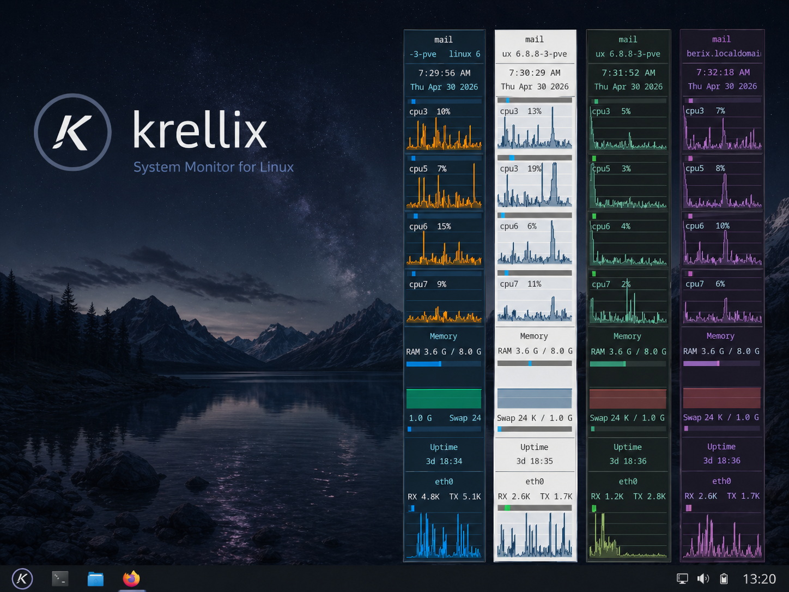

# krellix

A themeable Qt 6 desktop system monitor in the spirit of GKrellM.

A skinny vertical panel of stacked "krell" monitors — CPU, memory, disk, net, sensors,
and more — driven by a clean-sheet native theme format that any user can author.

**[Download Krellix](https://cerberix.org/extras/krellix/#downloads)** for Linux,
Intel Mac, or Windows.

## Install

The [Krellix download page](https://cerberix.org/extras/krellix/) lists current
packages and direct downloads. For Linux, set up the signed repository first
if you want updates through your package manager.

| Platform | Package | Installation |
| --- | --- | --- |
| Cerberix / Arch Linux (x86-64) | Pacman `.pkg.tar.zst` | [Repository setup](https://cerberix.org/extras/#repo-setup), then `sudo pacman -Syu krellix` |
| Ubuntu 24.04 (amd64) | `.deb` | [APT setup](https://cerberix.org/extras/#apt-setup), then `sudo apt install krellix` |
| Fedora 43 and 44 (x86-64) | `.rpm` | [DNF setup](https://cerberix.org/extras/#rpm-setup), then `sudo dnf install krellix` |
| macOS (Intel) | `.dmg` or `.tar.gz` | [Download the self-contained app](https://cerberix.org/extras/krellix/#downloads) |
| Windows (x64 preview) | Portable `.zip` | [Download the preview](https://cerberix.org/extras/krellix/#downloads), extract it, and run `krellix.exe` |

The optional Linux package `krellix-server` provides `krellixd` for remote
monitoring. Point the desktop client at that host with `krellix --host HOST`.
See the [plugin catalog](https://cerberix.org/extras/krellix/plugins/) and
[theme catalog](https://cerberix.org/extras/krellix/themes/) for add-ons.



## Build

Requires Qt 6.2+ and a C++17 compiler.

```bash
sudo apt install qt6-base-dev cmake g++   # Debian/Ubuntu
cmake -S . -B build
cmake --build build -j
./build/bin/krellix
```

Run with a specific theme:

```bash
./build/bin/krellix --theme default
```

## Themes

Themes live in:

- `~/.config/krellix/themes/<name>/` (user, takes precedence)
- `/usr/share/krellix/themes/<name>/` (system)

A theme is a directory containing `theme.json` plus any PNG sprites it references.
Start with the [theme author's guide](https://cerberix.org/extras/krellix/themes/#build-a-theme)
or the [Workbench example](examples/workbench). See [`docs/theme-spec.md`](docs/theme-spec.md)
for the format reference.

While krellix is running, edits to `theme.json` are picked up automatically — the
panel repaints on save, so theme authors can iterate without restarting the app.

## Plugin development

Follow the [plugin author's guide](https://cerberix.org/extras/krellix/plugins/#build-a-plugin)
to build the [KrellHello example](examples/krellhello). The
[SDK reference](docs/plugin-spec.md) describes discovery, linking, and monitor lifetimes.

## Feedback

Share feedback in [Discussions](https://github.com/yodabytz/krellix/discussions)
or [report a bug](https://github.com/yodabytz/krellix/issues).

## License

GPL-3.0-or-later. See [LICENSE](LICENSE).
